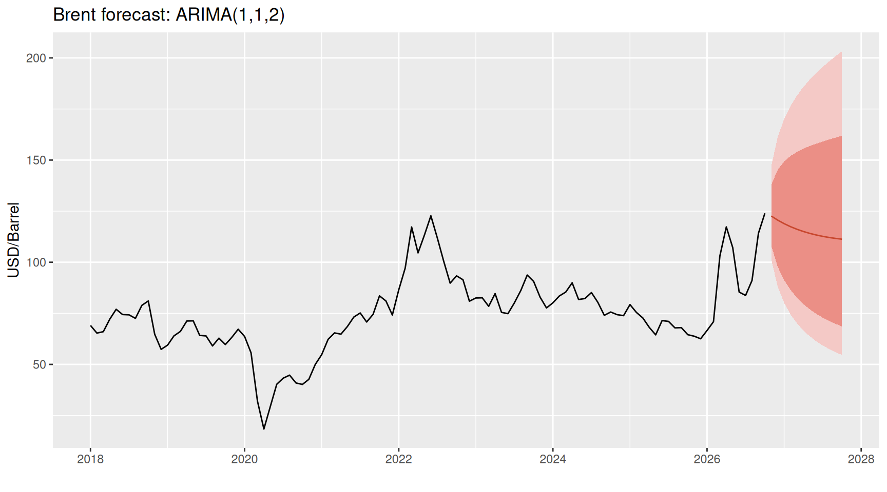
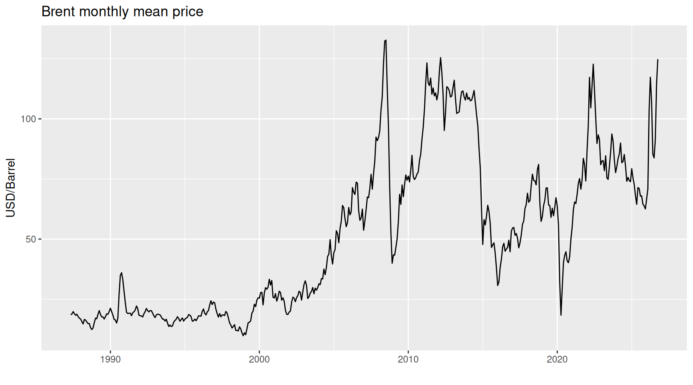
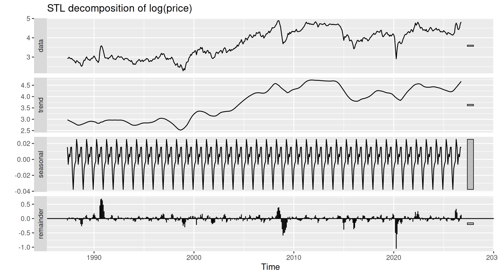
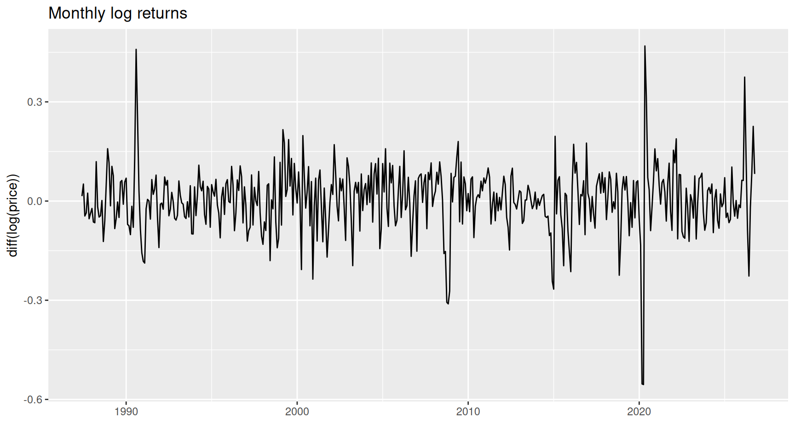
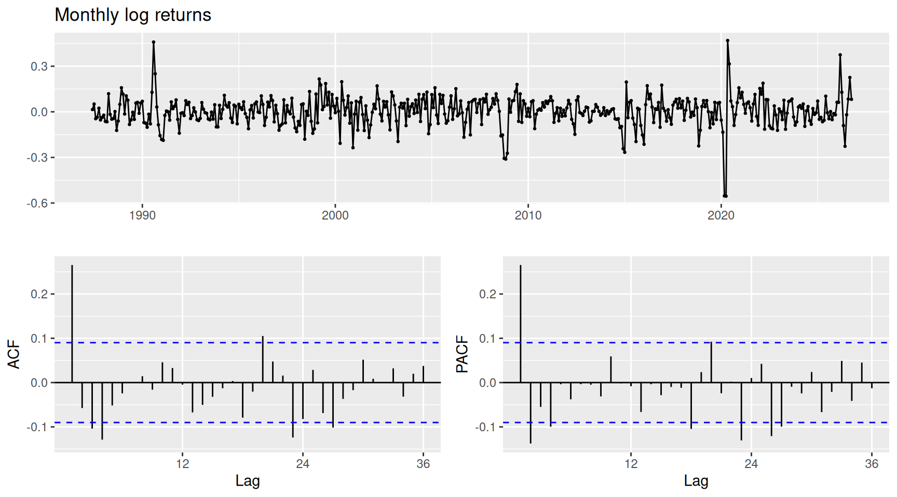
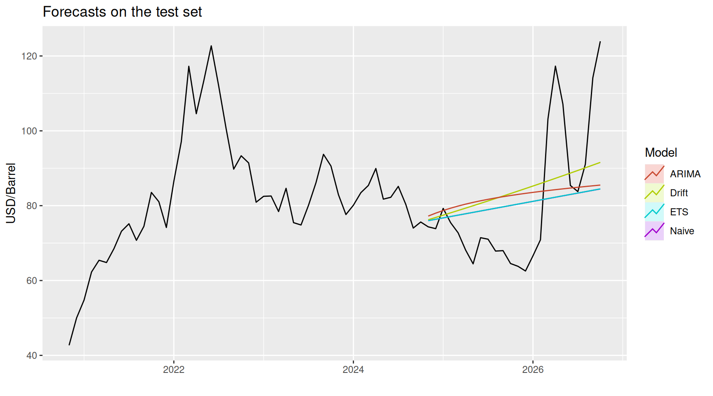
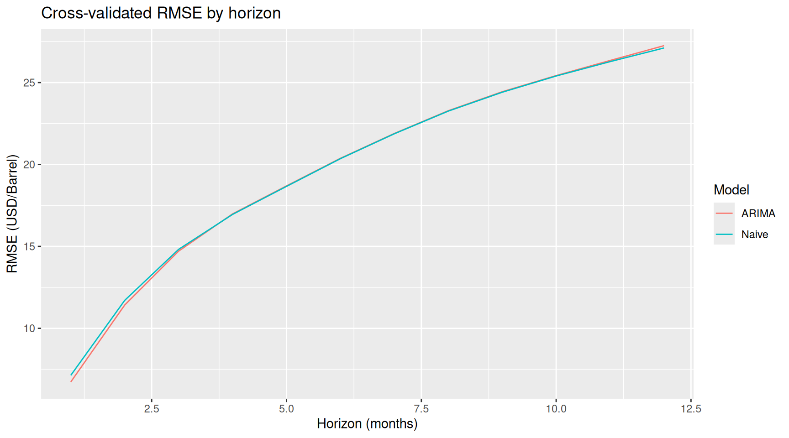
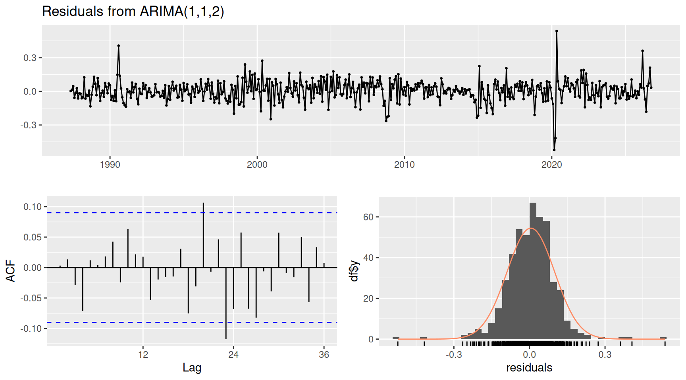

# OIL-PRICES — Brent price forecasting

[](https://github.com/EnriquePH/OIL-PRICES/actions/workflows/weekly-forecast.yml)
[](LICENSE)
[](https://www.r-project.org/)
[](https://pkg.robjhyndman.com/forecast/)
[](https://www.eia.gov/dnav/pet/hist/LeafHandler.ashx?n=PET&s=rbrte&f=D)
[](https://github.com/EnriquePH/OIL-PRICES/commits/main)
[](https://github.com/EnriquePH/OIL-PRICES)

<!-- badges:start -->
[](https://www.eia.gov/dnav/pet/hist/LeafHandler.ashx?n=PET&s=rbrte&f=D)
[](#key-results)
[](output/brent_forecast.csv)
<!-- badges:end -->

Monthly forecast of the **Europe Brent Spot Price FOB** (USD/barrel) with ARIMA models in R,
using the daily series published by the
[U.S. Energy Information Administration (EIA)](https://www.eia.gov/dnav/pet/hist/LeafHandler.ashx?n=PET&s=rbrte&f=D)
since 1987. The data, the models, the plots and this README are updated every Sunday by
GitHub Actions.

**Contents:** [Latest forecast](#latest-forecast) · [Key results](#key-results) ·
[Method](#method) · [Plots](#plots) · [Usage](#usage) · [Automation](#automation) ·
[Project structure](#project-structure) · [References](#references) · [License](#license)

## Latest forecast

Monthly mean price, USD/barrel, with 80 % and 95 % prediction intervals.



<!-- forecast:start -->
Model **ARIMA(1,1,2)** on log(price). Data until **2026-11-11** (last price 92.1 USD), updated 2026-11-15.

| Month | Forecast | 80 % interval | 95 % interval |
| --- | ---: | :---: | :---: |
| 2026-11 | 122.6 | 108.1 – 137.8 | 101.3 – 147.0 |
| 2026-12 | 120.6 | 97.8 – 145.2 | 88.1 – 161.3 |
| 2027-01 | 118.9 | 91.3 – 149.3 | 80.1 – 170.1 |
| 2027-02 | 117.4 | 86.4 – 152.0 | 74.4 – 176.5 |
| 2027-03 | 116.1 | 82.6 – 154.0 | 70.1 – 181.6 |
| 2027-04 | 115.0 | 79.5 – 155.6 | 66.6 – 185.8 |
| 2027-05 | 114.1 | 77.0 – 156.9 | 63.7 – 189.4 |
| 2027-06 | 113.3 | 74.8 – 158.0 | 61.3 – 192.6 |
| 2027-07 | 112.7 | 72.9 – 159.1 | 59.3 – 195.6 |
| 2027-08 | 112.1 | 71.3 – 160.0 | 57.5 – 198.3 |
| 2027-09 | 111.7 | 69.8 – 161.0 | 56.0 – 200.8 |
| 2027-10 | 111.3 | 68.6 – 161.9 | 54.6 – 203.2 |
<!-- forecast:end -->

[Download as CSV](output/brent_forecast.csv)

> The intervals are wide on purpose: oil prices behave almost like a random walk, so the
> uncertainty grows quickly with the horizon. Use the forecast as a baseline, not as a
> trading signal.

## Key results

<!-- results:start -->
*Generated by `Brent.Rmd` on 2026-11-15.*

### Data

- 9,128 daily prices from 1987-05-20 to 2026-11-11, 474 complete months. Maximum 143.9 USD (2008-07-03), minimum 9.1 USD (1998-12-10).
- Stationarity: log prices have a unit root (ADF p = 0.317, KPSS p = 0.010); monthly log returns are stationary (ADF p = 0.010, KPSS p = 0.100). `ndiffs` = 1.

### Test set: last 24 months (train until Oct 2024)

|      |  RMSE|   MAE|  MAPE| MASE|
|:-----|-----:|-----:|-----:|----:|
|Naive | 16.68| 12.95| 15.30| 0.97|
|Drift | 15.82| 13.16| 16.38| 0.99|
|ETS   | 16.68| 12.95| 15.30| 0.97|
|ARIMA | 17.11| 13.93| 16.98| 1.05|

Best model on the test set: **Drift**.

### Rolling cross-validation since 2005: ARIMA vs random walk

| Horizon (months)| ARIMA RMSE| Naive RMSE| ARIMA gain|
|----------------:|----------:|----------:|----------:|
|                1|       6.73|       7.13|      5.6 %|
|                2|      11.42|      11.71|      2.4 %|
|                3|      14.71|      14.82|      0.7 %|
|                6|      20.38|      20.36|     -0.1 %|
|               12|      27.25|      27.11|     -0.5 %|

ARIMA improves on the random walk at horizons 1, 2, 3 (best gain 5.6 % at h = 1).

### Final model

**ARIMA(1,1,2)** on log(price), fitted with all the data (AICc -880.2). Ljung-Box test on the residuals (24 lags): p = 0.137, no autocorrelation left.
<!-- results:end -->

## Method

1. **Data.** Daily Brent spot prices from the EIA Excel file (`RBRTEd.xls`), aggregated to
   monthly means. The current month is dropped until it is (almost) complete.
2. **Exploration.** Price history, STL decomposition of `log(price)` (trend, seasonality and
   remainder) and distribution of daily prices.
3. **Stationarity.** ADF (H0: unit root) and KPSS (H0: stationary) tests on log prices and
   on monthly log returns, ACF and PACF of the returns.
4. **Models.** All on the log scale (`lambda = 0`) with bias-adjusted back-transformation:
   - *Naive* (random walk): next month = last month. The standard benchmark for oil
     prices (Alquist, Kilian and Vigfusson, 2011).
   - *Drift*: random walk with the average historical trend.
   - *ETS*: exponential smoothing, automatic selection.
   - *ARIMA*: `auto.arima` with full search (`stepwise = FALSE`).
5. **Evaluation.**
   - Test set: the last 24 months are held out, models are trained on the rest.
   - Rolling origin cross-validation (`tsCV`) since 2005 for horizons of 1 to 12 months,
     ARIMA against the random walk.
6. **Final model.** ARIMA selected again with all the data, Ljung-Box test and residual
   checks, forecast for the next 12 months.

## Plots

### Monthly mean price
The long-run level changes with each oil cycle (1990, 2008, 2014, 2020, 2022…); there is
no fixed mean to return to.



### STL decomposition of log(price)
The trend dominates; the seasonal component is very small (a few percent), which is why
the models are not seasonal.



### Monthly log returns
Returns move around zero with periods of high volatility (2008, 2020).



### ACF and PACF of the returns
Most autocorrelations are inside the confidence bands: little short-term structure for a
model to exploit.



### Forecasts on the test set
Forecasts made from the start of the test period, against the real prices.



### Cross-validated RMSE by horizon
Average error of ARIMA and the random walk for each horizon. The error grows with the
horizon for both; the gap between the lines is the value added by the model.



### Residuals of the final model
Residuals should look like white noise: no pattern in time, no significant autocorrelation,
roughly normal (fat tails are expected in oil).



## Usage

Requires R and the packages `readxl`, `xts`, `forecast`, `tseries`, `ggplot2`, `plotly`
and `rmarkdown`.

```bash
Rscript Brent.R            # 12 month forecast (updates output/ and the table above)
Rscript Brent.R 24         # 24 month forecast
Rscript Brent.R --update   # download the latest EIA data first
Rscript -e "rmarkdown::render('Brent.Rmd')"   # full report: Brent.html, plots/, key results
```

The EIA file is downloaded again automatically when the local copy is older than 7 days.
The EIA publishes the daily series weekly, about one week behind, so the latest data point
is usually 5–10 days old.

## Automation

[`.github/workflows/weekly-forecast.yml`](.github/workflows/weekly-forecast.yml) runs on
GitHub's servers every Sunday at 06:00 UTC (and manually from the *Actions* tab):

1. Downloads the latest EIA data and runs `Brent.R --update`.
2. Renders `Brent.Rmd` (plots and key results).
3. Commits `data/`, `plots/`, `output/` and `README.md` when they change.
4. Attaches the full report `Brent.html` to the run (*Actions* → run → *Artifacts*).

GitHub pauses scheduled workflows in repositories without activity for 60 days; it can be
re-enabled from the *Actions* tab.

## Project structure

| Path | Description |
| --- | --- |
| `Brent.Rmd` | Full report. Renders to `Brent.html` (not tracked) and writes `plots/` and the key results. |
| `Brent.R` | Forecast script: `output/brent_forecast.csv`, `output/brent_forecast.png` and the forecast table. |
| `R/brent.R` | Shared functions: download, read, monthly aggregation, README update. |
| `data/RBRTEd.xls` | EIA data. |
| `plots/` | Report figures. |
| `output/` | Latest forecast. |
| `.github/workflows/` | Weekly update. |
| `LICENSE` | MIT license. |
| `draft/` | Old drafts (not tracked). |

## References

- R. J. Hyndman and G. Athanasopoulos, [*Forecasting: Principles and Practice* (2nd ed.)](https://otexts.com/fpp2/).
- R. Alquist, L. Kilian and R. J. Vigfusson (2011), [*Forecasting the Price of Oil*](https://www.federalreserve.gov/pubs/ifdp/2011/1022/ifdp1022.pdf), Federal Reserve IFDP 1022.
- [NIST/SEMATECH e-Handbook: 4-Plot](https://www.itl.nist.gov/div898/handbook/eda/section3/4plot.htm).
- [CRAN Task View: Time Series Analysis](https://cran.r-project.org/web/views/TimeSeries.html).
- EIA, [Europe Brent Spot Price FOB](https://www.eia.gov/dnav/pet/hist/LeafHandler.ashx?n=PET&s=rbrte&f=D).

## License

Code released under the [MIT License](LICENSE). The Brent price data come from the EIA,
whose data are public domain in the United States.
